<div align="center">


# NextWorkZone

**把待办、笔记、知识库和 Jira、Wiki、GitLab 放进同一个 Mac 原生应用**

[](https://github.com/tanner-sh/NextWorkZone/releases/latest)


[](LICENSE)

[下载](https://github.com/tanner-sh/NextWorkZone/releases/latest) · [功能](#功能) · [安装](#安装) · [数据与隐私](#数据与隐私) · [开发](#开发)

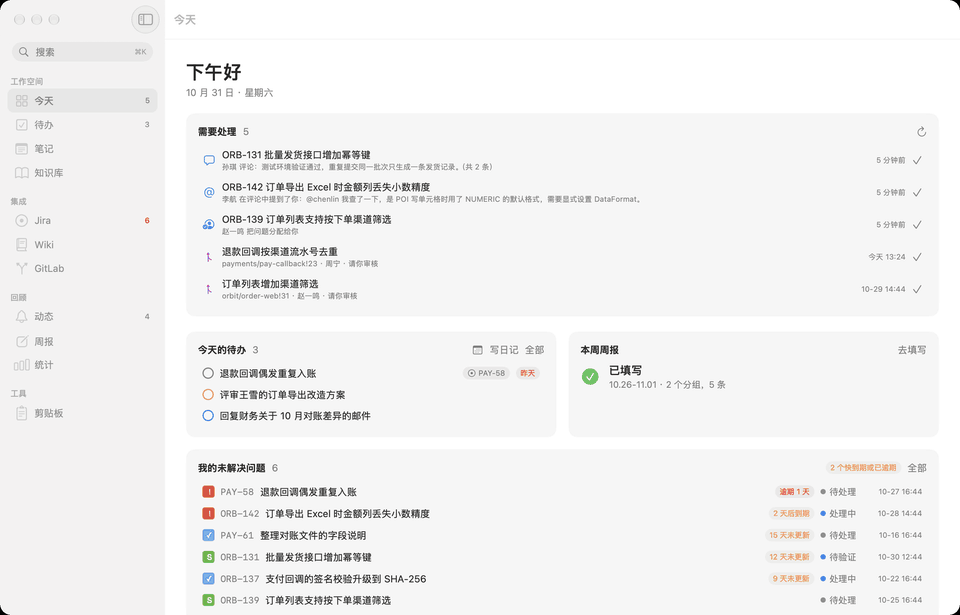

</div>

每天的工作散落在 Jira、Wiki、GitLab 和一堆便签里。NextWorkZone 把它们收拢到一个窗口：
分配给你的问题自动变成待办，笔记里写下问题键就能看到实时状态，解决过的问题一键沉淀到知识库，周报按这一周做过的事自动起草。

- **原生**：Swift 6 + SwiftUI，适配 macOS 26 的 Liquid Glass；只用系统框架，没有第三方依赖
- **本机优先**：工作空间数据存在本机 SQLite，凭据存在钥匙串；可以通过同步文件夹在多台 Mac 之间同步
- **连接你自己的服务器**：Jira、Confluence 的 Server / Data Center 版和 GitLab，地址和令牌都可配置，不用的系统可以不填

> 下面的截图都使用虚构的演示数据。

## 功能

### 今天

打开应用先看到今天要处理的事：分配给你的问题、评论和 @、到期提醒、等你审核的合并请求；
可以标为已处理、稍后提醒或转成待办。下面是今天的待办、本周周报、我的未解决问题、今天的工作记录和最近看过的 Wiki。

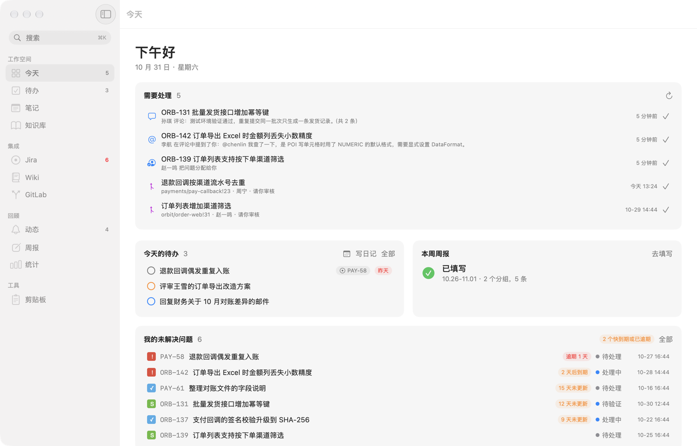

### 待办 · 笔记 · 知识库

| | |
|:---:|:---:|
| 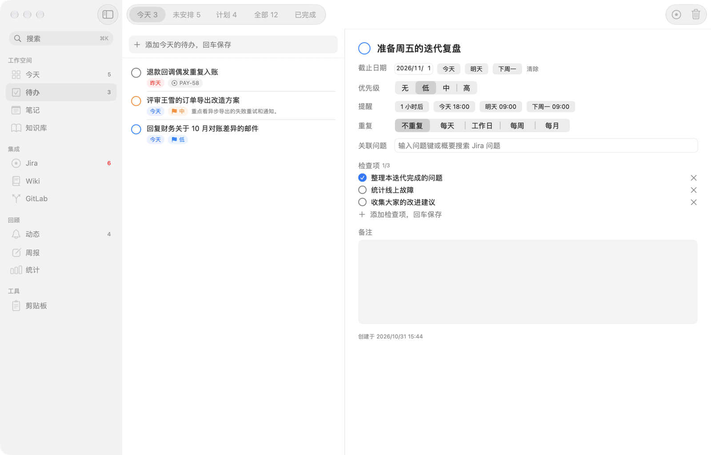 | 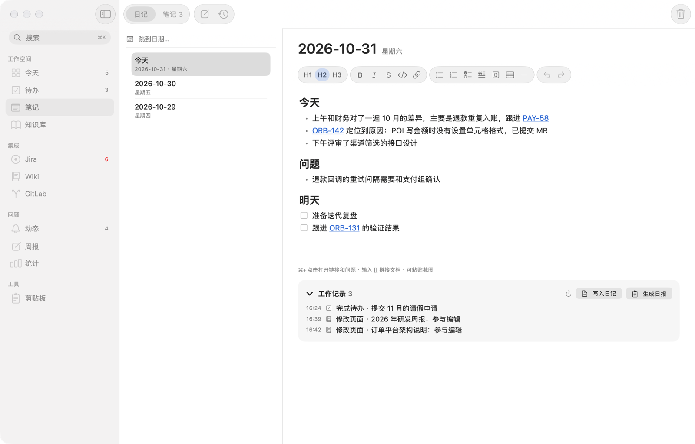 |
| **待办**：今天、计划、未安排分组；截止日期、优先级、提醒、重复、检查项，全部可撤销。Jira 问题和 Wiki 页面中的任务自动进入待办，随时按 ⌘⇧N 快速记录 | **笔记与日记**：所见即所得的编辑器，问题键显示实时状态，`[[` 链接其他文档，可以粘贴截图；日记下方汇总当天的工作记录，一键写入日记或生成日报 |
| 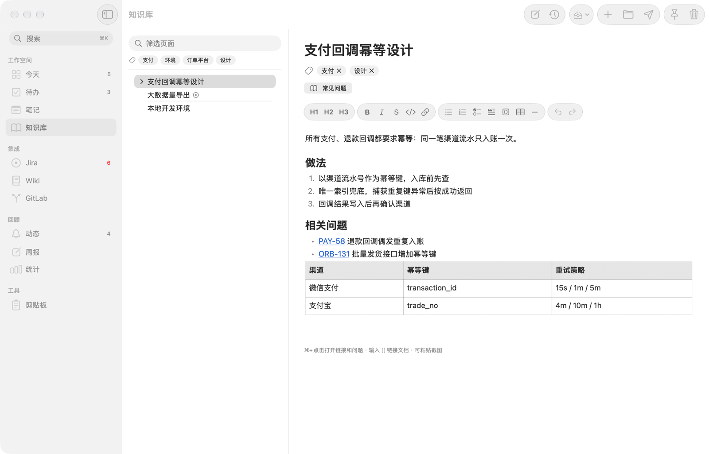 | 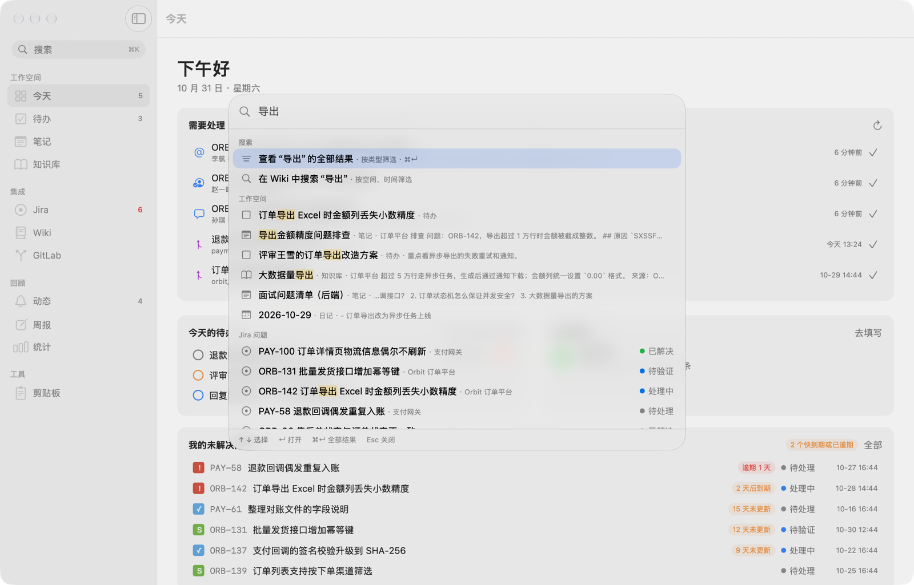 |
| **知识库**：树状页面和标签；把解决过的 Jira 问题、常看的 Wiki 页面沉淀进来，也可以发布到 Wiki | **统一搜索（⌘K）**：一次搜索工作空间、本机问题库、本机 Wiki 库、剪贴板历史和服务器，也可以直接跳到任何页面 |

### Jira · Wiki · GitLab

不用打开浏览器就能完成日常操作。

| | |
|:---:|:---:|
| 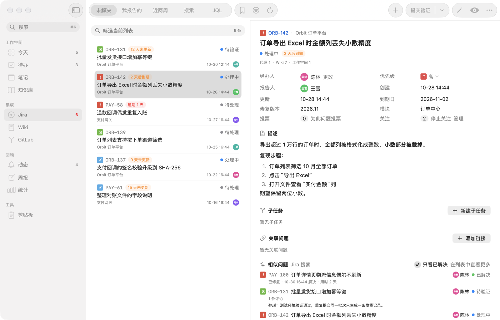 | 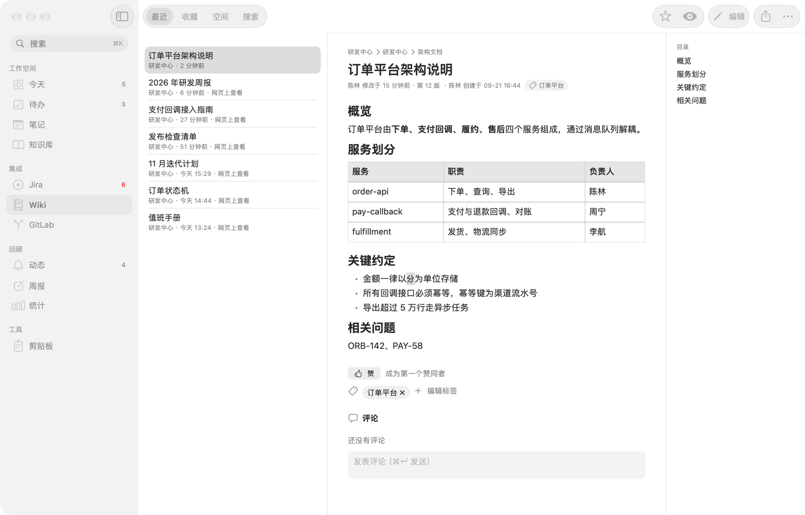 |
| **Jira**：常用查询、JQL、排序分组；详情中流转、编辑字段、评论、附件、工作日志、关注投票；相似问题和本机问题库，搜索不必等服务器 | **Wiki**：最近、收藏、空间和页面树；阅读时自动生成目录，Jira 宏显示实时状态；编辑、历史版本对比、评论、导出 |
| 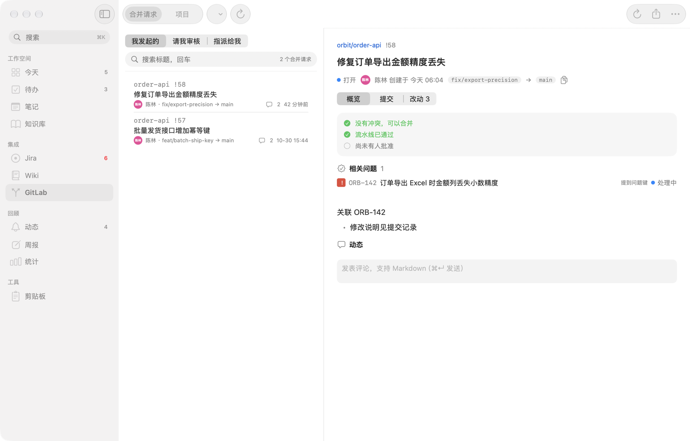 | 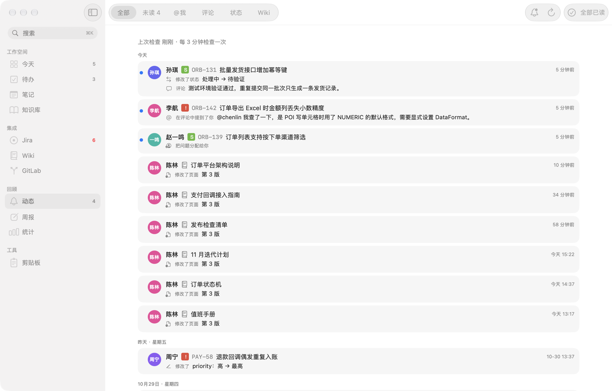 |
| **GitLab**：我发起的、请我审核的合并请求，流水线和合并状态、改动、评论；项目的代码、提交、分支和对比 | **动态**：每 3 分钟检查你经办、报告、关注的问题和 Wiki 页面，别人的评论、@、流转和修改都在这里，可以按类型筛选、发系统通知 |

### 周报 · 统计

| | |
|:---:|:---:|
| 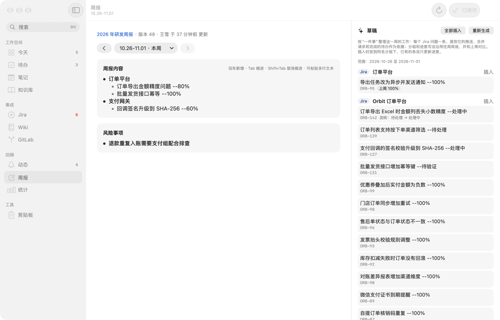 | 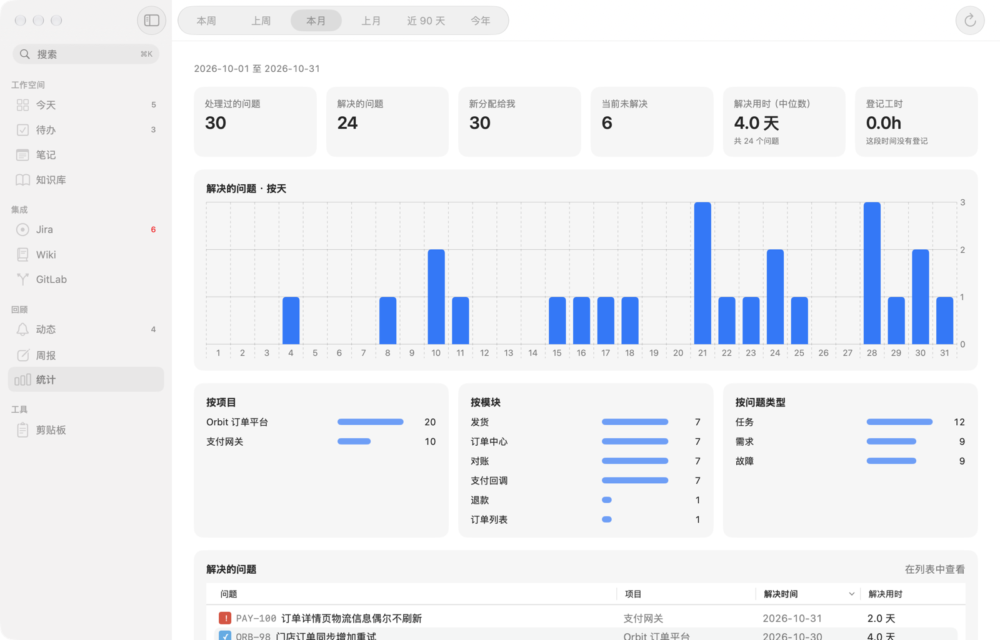 |
| **周报**：直接编辑共享 Wiki 页面中自己那一行；按这一周的推送、合并请求、流转和完成的待办起草，沿用往周的分组和写法，保存前对比改动，不会覆盖别人的内容 | **统计**：按本周、本月、近 90 天等时间段统计处理和解决的问题、解决用时，按项目、模块、类型分布 |

### 还有

- **剪贴板历史**：记录复制过的文字、图片和文件，⌥⌘V 在任何应用中搜索、粘贴，常用内容可以置顶；自动跳过密码等敏感内容
- **快速记录**：⌥Space 在任何应用中记一条待办或一段日记
- **多窗口**：问题、Wiki 页面、笔记都可以在新窗口中打开
- **深色模式**、菜单栏图标、系统通知、系统共享、VoiceOver 读屏标签

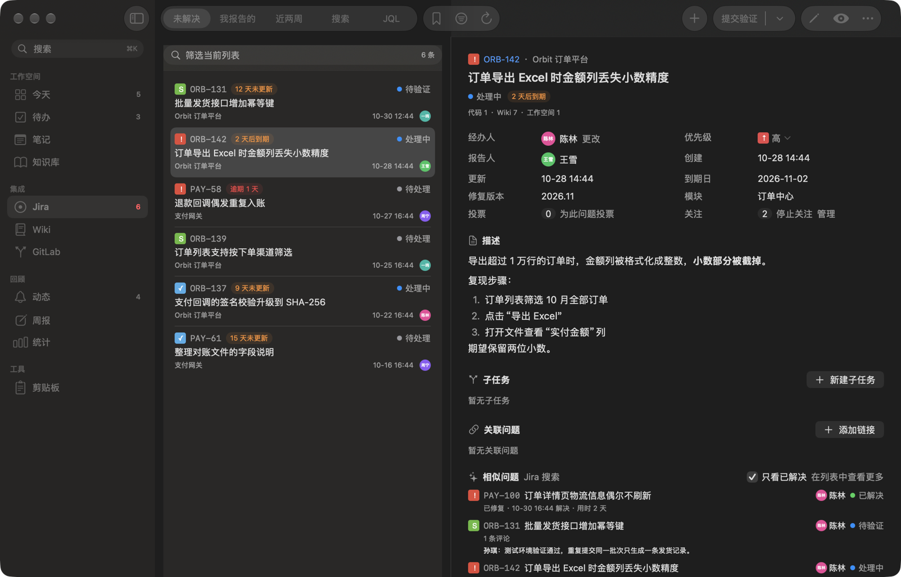

## 安装

从 [Releases](https://github.com/tanner-sh/NextWorkZone/releases/latest) 下载 `NextWorkZone-<版本>-macos-arm64.zip`，解压后把 `NextWorkZone.app` 拖到“应用程序”。

- 需要 macOS 26 及以上、Apple 芯片的 Mac。
- 应用没有经过 Apple 公证，第一次打开时系统会提示无法验证开发者。可以在“系统设置 > 隐私与安全性”中点“仍要打开”，
  或者在终端中去掉下载带来的隔离属性后再打开：

  ```sh
  xattr -dr com.apple.quarantine /Applications/NextWorkZone.app
  ```

- 发布包是临时签名的，每次更新后第一次读取钥匙串中的凭据时，系统会再询问一次是否允许，选择“始终允许”即可。
- 第一次打开后在设置（⌘,）的“连接”中填写 Jira、Wiki、GitLab 的地址和个人访问令牌；不用的系统可以不填。

## 数据与隐私

- 应用只连接你在设置中填写的服务器，不收集、不上传任何使用数据。
- 待办、笔记、知识库保存在 `~/Library/Application Support/NextWorkZone/`；本机问题库、Wiki 库等可以重建的缓存在 `~/Library/Caches/NextWorkZone/`。
- 令牌和密码保存在钥匙串中。
- 多设备同步只读写你选择的同步文件夹（iCloud Drive、坚果云、NAS 等），每台设备只追加写自己的变更日志。

## 开发

跨平台的 Tauri 版已停止维护，见 [NextWorkZone-Tauri](https://github.com/tanner-sh/NextWorkZone-Tauri)。

```sh
macos/build.sh             # 开发版：macos/build.noindex/NextWorkZone.app
macos/build.sh release     # 正式版（同一位置）
ditto macos/build.noindex/NextWorkZone.app /Applications/NextWorkZone.app   # 安装正式版
macos/test.sh              # 测试（swift-testing）
macos/release.sh           # 打包发布：临时签名的正式版 zip 和 sha256，放在 macos/build.noindex/dist/
macos/icon.sh              # 重新生成应用图标（需要 Xcode）
```

只需要命令行工具，不需要 Xcode。脚本固定使用 macOS 26 SDK（命令行工具中 27 的 SDK 缺少 SwiftUI 的宏插件），
并选择 SwiftPM 的原生构建引擎（默认引擎会忽略外部 SDK 路径）。
应用图标的源文件是 `macos/Icon/AppIcon.icon`（用 Icon Composer 编辑），修改后运行 `macos/icon.sh` 重新生成 `Resources` 中的图标文件。

开发版与正式版的数据互不共享，可以同时运行：

| | 正式版 | 开发版 |
|---|---|---|
| 数据 | `~/Library/Application Support/NextWorkZone/` | `…/NextWorkZone-dev/` |
| 缓存（可重建的本机库） | `~/Library/Caches/NextWorkZone/` | `…/NextWorkZone-dev/` |
| 凭据 | 钥匙串中 service 为 `NextWorkZone`、account 为 `credentials` 的单一条目 | 数据目录下的 `dev-credentials.json`（0600） |

开发版可以用环境变量 `NWZ_DATA_DIR` 指向临时目录，配置、凭据、界面偏好和缓存都会放到那里，测试时不影响自己的数据。
开发版带本机调试通道（`DevBridge.swift`，只监听 127.0.0.1，只允许调用只读命令）。

不启动界面、只读检查各系统（先在开发版设置页保存地址与令牌）：

```sh
cd macos
export DEVELOPER_DIR=/Library/Developer/CommandLineTools SDKROOT=/Library/Developer/CommandLineTools/SDKs/MacOSX26.sdk
swift build --build-system native --sdk "$SDKROOT" --product NWZTool
TOOL=.build/arm64-apple-macosx/debug/NWZTool
$TOOL ping                                  # 三个系统的账号和版本
$TOOL ping wiki --data-dir /tmp/nwz-test
$TOOL jira-search "assignee = currentUser()"
```

`NWZTool` 只读取开发版的配置和凭据，不会修改远端内容；未配置或连接失败时返回非零退出码。

## 结构

`macos/` 是一个 SwiftPM 包，依赖方向只从上往下：界面 → `NWZServices` → 各业务模块 → `NWZRich` / `NWZCore`。
业务模块不依赖 AppKit 和 SwiftUI，需要平台能力的地方（通知、快捷键、剪贴板、粘贴）通过协议由界面提供。

| 模块 | 说明 |
|---|---|
| `NWZCore` | 配置、钥匙串凭据、HTTP 客户端（代理含 SOCKS5、GET 自动重试、凭据不随跨站重定向发出）、SQLite 封装、缓存、事件协议 |
| `NWZRich` | 富文本的统一文档模型，以及与 HTML（系统 libxml2）、Markdown、Jira wiki 标记、Confluence XHTML 之间的转换；编辑 Wiki 时保留未修改的内容 |
| `NWZJira` | Jira REST v2：搜索、详情、流转、评论、附件、分配、关注、工作日志、字段元数据、动态；本机问题库与相似问题 |
| `NWZWiki` | Confluence REST v1：浏览、历史版本、评论、模板；storage 扫描、纯文本与任务提取、版本差异、页面编辑；本机 Wiki 库；周报读写 |
| `NWZGitLab` | GitLab REST v4：项目、分支、目录树、文件、提交、对比；合并请求；链接识别与代码引用 |
| `NWZWorkspace` | 工作空间本地数据：待办、文档、图片、引用与全文索引、收件箱、多设备同步 |
| `NWZPreview` | 附件预览：Excel（xlsx/xls/xlsb/ods）/ CSV 表格、Word 段落、文本（自动识别 UTF-8 / GB18030）、ZIP 文件清单 |
| `NWZClipboard` | 剪贴板历史的存储、分类、隐私过滤、置顶板 |
| `NWZServices` | 把以上模块组装成应用的各项功能：设置、各系统服务、统一搜索、网页登录、剪贴板记录、后台同步与提醒 |
| `NWZTool` | 命令行调试工具（只读） |
| `NextWorkZone` | 界面（SwiftUI + AppKit）：主窗口、菜单栏图标、剪贴板面板、快速记录、全局快捷键 |
| `Tests/NWZTests` | 测试，离线数据在 `Fixtures/` |

## 关键设计

- **认证**：REST API 使用个人访问令牌（PAT）。附件、图片等网页路径先尝试用令牌访问；若服务器要求单独的网页登录（例如启用了 2FA / SSO），通过应用内的“网页登录”窗口获取会话（可配置账号密码自动填写，后台每 10 分钟保活一次）。会话 Cookie 保存在数据目录的 `web-sessions.json`（0600）。
- **凭据存储**：正式版全部凭据存在钥匙串的一个条目中，每次安装新版本后最多只弹出一次钥匙串授权；开发版存放在 `dev-credentials.json`，避免每次重新编译后反复授权。
- **周报**：每周一个以日期范围开头的一级标题，表格中第一列为自己名字的那一行即为自己的周报；只改写这一行的后续单元格，页面其余内容逐字节保持不变；保存时基于最新版本改写，遇到版本冲突会自动重试；如果自己那一行在网页端被改过，会提示冲突，不会覆盖。
- **工作空间数据**：待办与文档（笔记、日记、知识库页面）存在数据目录的 `workspace.sqlite`，正文为 Markdown；图片以 `ws://asset/<id>` 引用，文档之间以 `ws://doc/<id>` 链接。问题键、文档链接在保存时提取为引用关系，用于反向链接和问题页上的“工作空间”区块。
- **相似问题**：Jira 按单字索引中文，多字词会被当成“这些字都出现”。所以把概要拆成相邻两字的组合（去掉常用词和含虚词的组合），用 OR 连接查询，不指定排序时 Jira 按相关度返回。本机问题库可用时直接在本机查。
- **动态**：Jira Server 没有通知接口。每 3 分钟查询经办、报告、关注或提到我的、最近更新过的问题，从评论和变更记录中找出上次检查之后别人造成的变化，保存在本机并记录已读；每次多看 5 分钟以应对索引延迟，重复的按 id 去掉。第一次检查回看 3 天，直接标为已读。
- **计时**：同一时间只计一个，状态保存在本机；停止后登记为所选问题的工作日志。
- **多设备同步**：在设置中选择一个同步文件夹（iCloud Drive、坚果云、NAS 等）。每台设备只追加写自己的变更日志 `NextWorkZone/v2/devices/<设备>.jsonl`，读取其他设备的日志按修改时间合并；删除使用墓碑标记。文档记录了“基于哪个版本修改”，两台设备各自修改同一篇时，本地版本另存为“冲突副本”，内容不会丢。日志超过 8MB 时整理为最新版本，并更换代号通知其他设备从头读取。
- **本机问题库**：自动范围为最近 730 天内自己担任经办人或报告人的项目，存在缓存目录的 `jira-index.sqlite`，启动 15 秒后开始同步、之后每 10 分钟一次。用于问题搜索、相似问题、剪贴板中问题键的状态，以及统一搜索的本机这一步。
- **Wiki**：应用内浏览空间和页面树、阅读页面（Jira 宏显示实时状态、页面任务可勾选、自动生成目录）、查看历史版本差异、评论。
  Jira、Wiki、GitLab 的链接在应用内打开（含 `/x/` 短链接、`/display/空间/标题`），附件在应用内预览。
- **本机 Wiki 库**：页面标题和正文（转为按段落分行的纯文本）存在缓存目录的 `wiki-index.sqlite`，按最后修改时间增量同步，每天对比一次页面 id 清理已删除的页面；
  超长页面导致一批请求超时时自动缩小批量，单个页面失败则跳过。3 个字及以上的关键词先用 trigram 全文索引找候选页面再逐页确认。
  用于全文搜索、问题详情中“引用此问题的 Wiki 页面”（另合并 Jira 的远程链接）、找出 @我 的页面任务（同步为待办，勾选后回写 Wiki）。
- **编辑 Wiki 页面**：storage 本身是 XHTML，段落、标题、列表、表格、文字格式直接可视化编辑；宏、图片、页面链接、任务列表等替换为不可编辑的占位块，
  保存时换回原文，逐字节不变（未修改时与原文只差实体写法，如 `&rarr;` 与 `→`）。保存前显示文字差异，并检查页面是否在编辑期间被别人修改过，是则不覆盖。
- **知识库与 Wiki**：剪藏和发布时在地址中记下版本（`pageVersion=`），原页面有更新时提示并可查看变化、重新剪藏；再次发布时更新上次发布的页面，页面被别人改过时需确认才覆盖。
- **剪贴板历史**：每 300 毫秒比较一次剪贴板的变化序号，有变化才读取内容；带“不要记录”标记的内容（密码管理器复制的密码等）、疑似密钥和随机密码、忽略的应用中复制的内容都不记录。相同内容只保存一份，再次复制时移到最前面；本应用写回剪贴板的内容不算新条目。数据只保存在本机，不参与同步。
- **统一搜索（⌘K）**：分两步。输入停顿 100 毫秒后查本机的工作空间、本机问题库、本机 Wiki 库和剪贴板历史（同时查询）；停顿 250 毫秒后查服务器（本机库不可用的系统，以及本机库中没有的问题键、GitLab 项目和合并请求）。

## 许可证

[MIT](LICENSE)
